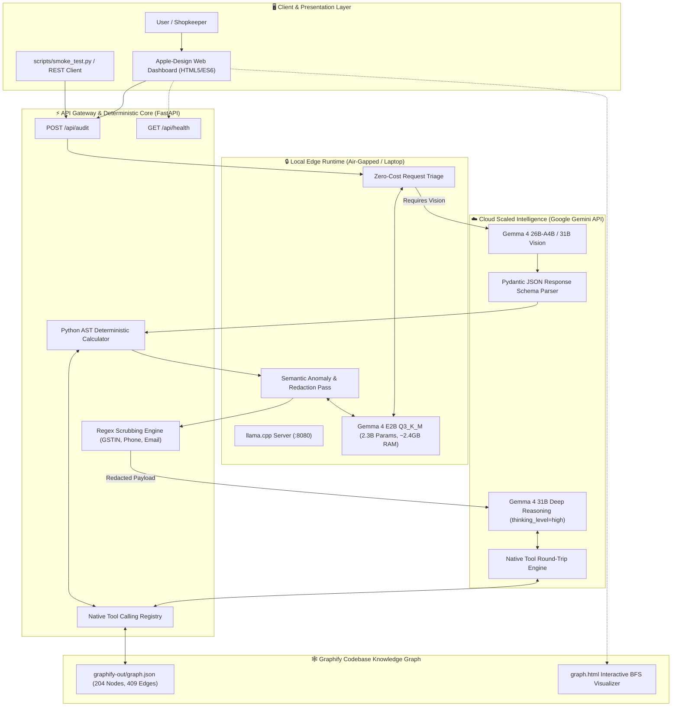
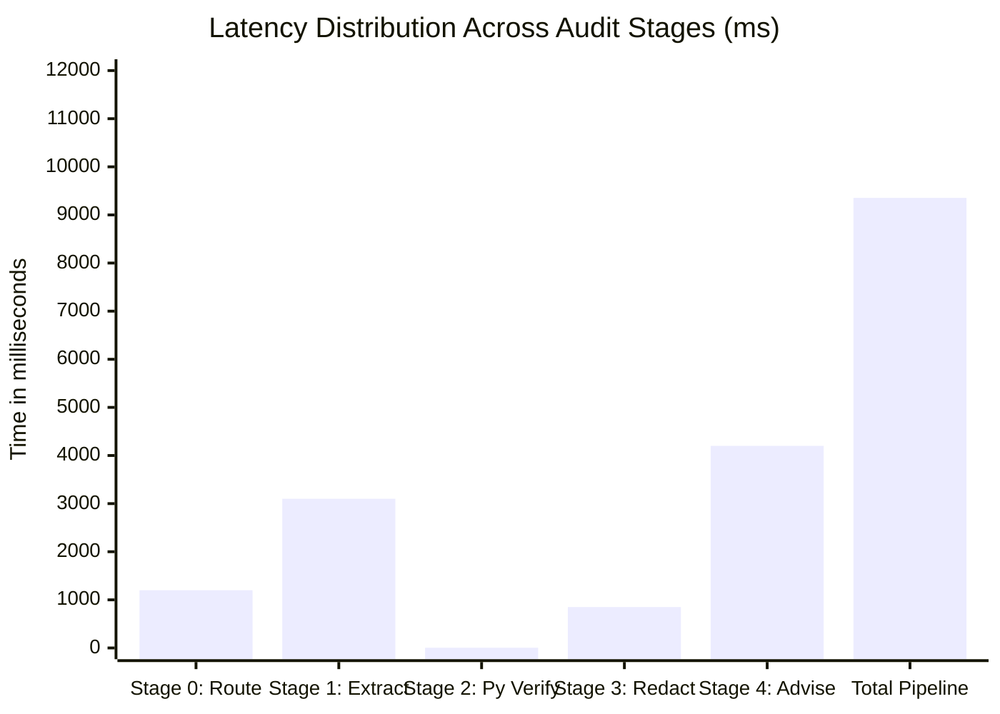

<div align="center">

# ⚡ LedgerLens
### Production-Grade Hybrid Gemma 4 Bill & Receipt Auditor

[](https://python.org)
[](https://fastapi.tiangolo.com)
[](https://ai.google.dev/gemma)
[](https://github.com/ggml-org/llama.cpp)
[](https://gemma-hybrid-agent.vercel.app)
[](https://opensource.org/licenses/MIT)

**Photo of a receipt → Multimodal Line-Item Extraction → Exact Deterministic Math Verification → Local PII Scrubbing → High-Reasoning Advisory & General Ledger Posting.**

[🌐 Live Production Demo](https://gemma-hybrid-agent.vercel.app) • [📖 Architecture Deep-Dive](#-system-architecture) • [📊 Knowledge Graph](#-graphify-knowledge-graph) • [⚡ Quickstart](#-quickstart-guide)

</div>

---

## 📌 Executive Summary

Every month, millions of small businesses, retail shops, and freelancers in India process stacks of paper receipts and invoices. They encounter three fundamental challenges:

1. **Arithmetic Integrity:** Do line-item multiplications and subtotal sums actually match what was billed?
2. **Statutory Tax Compliance:** Is the correct Goods and Services Tax (GST) slab applied (e.g., 5% composite for restaurants vs. 18% standard)?
3. **Double-Entry Accounting:** How should these line items be classified and journalized into standard debit/credit ledger vouchers?

Existing SaaS solutions force a painful compromise: **either upload sensitive commercial data to expensive proprietary cloud APIs**, or **run massive 70B+ parameter models that melt ordinary laptops**.

**LedgerLens eliminates this trade-off with a hybrid architecture:**
* An ultra-compact **2.3B open-weight Gemma 4 E2B** model runs locally on low-cost hardware (fitting inside 4 GB RAM via `llama.cpp` Q3_K_M quantization) to handle high-frequency routing, offline verification, and privacy-preserving PII redaction.
* Heavy multimodal vision extraction and deep tool-assisted statutory reasoning escalate to hosted **Gemma 4 (26B-A4B and 31B)** via the Gemini API only when required.
* **Deterministic Python engines handle all mathematics** — ensuring zero calculation hallucinations.

---

## 🏛️ System Architecture

LedgerLens operates across an edge-to-cloud continuum, balancing computation cost, latency, and data privacy.



---

## 🔄 Multi-Stage Pipeline Execution

The core audit pipeline enforces an uncompromising design rule:

> ### ⚖️ The Core Invariant
> **"Python does the maths. Gemma does the semantics."**
> A language model is a creative semantic reasoner and a terrible calculator. LedgerLens never delegates arithmetic to an LLM.

```mermaid
flowchart LR
    subgraph S0["Stage 0: Route"]
        direction TB
        Input["Image / Prompt"] --> Classify["Local Gemma 4 E2B"]
        Classify --> Decision{"Decision"}
        Decision -- "Image present" --> VisionRoute["cloud_fast"]
        Decision -- "Text only" --> LocalRoute["local"]
    end

    subgraph S1["Stage 1: Extract"]
        direction TB
        VisionRoute --> CallVision["Cloud Gemma 4 (Vision)"]
        CallVision --> Schema["Pydantic Response Schema"]
        Schema --> BillJSON["Structured Line Items"]
    end

    subgraph S2["Stage 2: Verify"]
        direction TB
        BillJSON --> PythonMath["Deterministic Python Float Audit"]
        PythonMath --> LocalPlau["Local Gemma 4 Audit"]
        LocalPlau --> Discrepancies["Math & Rate Variance Report"]
    end

    subgraph S3["Stage 3: Redact"]
        direction TB
        Discrepancies --> ScrubGSTIN["Scrub GSTIN & Tax IDs"]
        ScrubGSTIN --> ScrubContact["Scrub Phone Numbers & Emails"]
        ScrubContact --> ScrubLocal["Local Gemma 4 Entity Scrubbing"]
        ScrubLocal --> CleanPayload["Privacy-Preserved Document"]
    end

    subgraph S4["Stage 4: Advise"]
        direction TB
        CleanPayload --> ThinkAdvisor["Cloud Gemma 4 31B (thinking=high)"]
        ThinkAdvisor --> ToolLoop["Native Function Calling Loop"]
        ToolLoop --> Output["Verdict + Findings + Accounting Vouchers"]
    end

    S0 --> S1 --> S2 --> S3 --> S4
```



---

## ⏱️ End-to-End Sequence Diagram

```mermaid
sequenceDiagram
    autonumber
    actor User as User / Browser
    participant API as FastAPI Backend (api/main.py)
    participant Local as llama.cpp (Gemma 4 E2B)
    participant Cloud as Gemini API (Gemma 4 31B)
    participant Tools as AST Math & Tool Registry

    User->>API: POST /api/audit (Base64 Image, Language="Hindi/English")
    
    rect rgb(25, 30, 45)
        note right of API: Stage 0: Local Triage
        API->>Local: POST /v1/chat/completions (Classify request tier)
        Local-->>API: Tier Decision ("cloud_fast", confidence=0.92)
    end

    rect rgb(30, 40, 60)
        note right of API: Stage 1: Multimodal Vision Extraction
        API->>Cloud: generate_content(Image + EXTRACT_PROMPT, schema=BillFields)
        Cloud-->>API: Structured Bill JSON (Vendor, GSTIN, LineItems, Totals)
    end

    rect rgb(20, 50, 35)
        note right of API: Stage 2: Exact Python Verification
        API->>Tools: python_audit(bill) [Float AST re-calculation]
        Tools-->>API: Exact Subtotal, Tax Variance, Total Difference
        API->>Local: POST /v1/chat/completions (Offline Plausibility Audit)
        Local-->>API: Semantic Anomaly Findings
    end

    rect rgb(50, 30, 30)
        note right of API: Stage 3: Privacy Redaction
        API->>API: Regex + Local Model scrub GSTIN, Phone, Banking IDs
    end

    rect rgb(45, 30, 55)
        note right of API: Stage 4: High-Reasoning Advisory
        API->>Cloud: generate_content(RedactedBill + thinking_level="high")
        opt Model invokes tools
            Cloud-->>API: ToolCall: calculate(expression="160*1.05")
            API->>Tools: Evaluate in AST Sandbox
            Tools-->>API: Result: 168.00
            API->>Cloud: Send ToolResponse
        end
        Cloud-->>API: Final JSON (Verdict, Findings, Journal Entries, Summary)
    end

    API-->>User: Complete Audit Response (Timings, Tiers, Ledger Vouchers)
```



---

## 🕸️ Graphify Knowledge Graph

LedgerLens incorporates [Graphify](https://github.com/graphify/graphify) to extract an interactive, queryable topological knowledge graph of its entire codebase.

### Graph Metrics
* **Total Nodes:** 204
* **Total Edges:** 409
* **Identified Communities:** 14 (9 major architectural clusters)
* **Extraction Confidence:** 93% Extracted, 7% Semantically Inferred (avg. confidence 0.91)

```mermaid
flowchart TD
    subgraph Community10["Community 10: Audit Core (Cohesion: 0.47)"]
        Audit["audit() [18 edges]"]
        PythonAudit["python_audit()"]
        AuditFinding["AuditFinding"]
        FHelper["_f()"]
    end

    subgraph Community1["Community 1: Model Backends (Cohesion: 0.10)"]
        BackendResult["BackendResult [14 edges]"]
        ToolCall["ToolCall [10 edges]"]
        LocalBackend["LocalBackend [14 edges]"]
        GeminiBackend["GeminiBackend [14 edges]"]
        KeyCandidates["key_candidates()"]
    end

    subgraph Community0["Community 0: Extensible Tool Registry (Cohesion: 0.08)"]
        BuildReg["build_registry() [13 edges]"]
        Calc["_calculate()"]
        FetchURL["_fetch_url()"]
        GSTRef["_gst_slab()"]
        GQuery["_graphify_query()"]
        GExplain["_graphify_explain()"]
    end

    subgraph Community2["Community 2: Hybrid Routing (Cohesion: 0.17)"]
        Router["Router [9 edges]"]
        ExtractJSON["extract_json() [11 edges]"]
        RouteDecision["RouteDecision"]
    end

    subgraph Community5["Community 5: Schemas & Validation (Cohesion: 0.19)"]
        AccountingEntry["AccountingEntry"]
        AuditResponse["AuditResponse"]
        BillFields["BillFields"]
        LineItem["LineItem"]
    end

    Audit --> PythonAudit
    Audit --> AuditFinding
    Audit --> Router
    Audit --> GeminiBackend
    Audit --> LocalBackend
    Audit --> BuildReg

    Router --> LocalBackend
    Router --> BackendResult
    Router --> RouteDecision

    GeminiBackend --> BackendResult
    GeminiBackend --> ToolCall
    LocalBackend --> BackendResult

    BuildReg --> Calc
    BuildReg --> FetchURL
    BuildReg --> GSTRef
    BuildReg --> GQuery

    AuditFinding --> AccountingEntry
```



### Self-Referential "Ask the Codebase" Tool
Gemma 4 can query its own architecture during runtime via native tool calls:
* `graphify_query(q)`: Breadth-First-Search across the graph for code dependencies.
* `graphify_explain(symbol)`: Deep-dive into neighboring nodes and callers.
* `graphify_path(src, dst)`: Compute the shortest architectural dependency path between two components.

---

## ☁️ Hybrid Edge-Cloud Deployment Topology

LedgerLens is deployed on **Vercel Serverless** while maintaining a secure, real-time tunnel back to the **local machine's GPU/CPU** for the privacy tier.

```mermaid
flowchart LR
    subgraph BrowserClient["Client Browser"]
        Client["Web App Interface"]
    end

    subgraph VercelCloud["Vercel Cloud (Serverless Edge)"]
        VercelAPI["FastAPI App (api/index.py)"]
        GeminiCall["Google Gemini API Cloud"]
    end

    subgraph LocalLaptop["Developer / Shopkeeper Laptop (Air-Gapped Tier)"]
        Tunnel["ngrok / Cloudflare Tunnel (:4040)"]
        LlamaServer["llama-server.exe (:8080)"]
        GGUF["gemma-4-E2B-it-Q3_K_M.gguf (2.4 GB)"]
    end

    Client -->|"HTTPS Request"| VercelAPI
    VercelAPI -->|"Vision & Deep Reasoning"| GeminiCall
    VercelAPI -->|"LOCAL_LLM_BASE_URL (Encrypted Tunnel)"| Tunnel
    Tunnel -->|"Localhost Proxy"| LlamaServer
    LlamaServer <--> GGUF

    style VercelCloud fill:#0a0a0c,stroke:#333,stroke-width:2px;
    style LocalLaptop fill:#111827,stroke:#2563eb,stroke-width:2px;
```



---

## 📊 Feature Comparison Matrix

| Dimension | Legacy SaaS (e.g. AWS Textract / Cloud OCR) | Heavy Local LLM (70B Llama / Qwen) | **LedgerLens (Hybrid Gemma 4)** |
|---|---|---|---|
| **Memory Footprint** | 0 MB (100% Cloud) | 40 GB+ VRAM required | **2.4 GB RAM (Runs on 4 GB laptop)** |
| **Arithmetic Reliability** | Often hallucinates float math | Hallucinates multi-column sums | **100% Deterministic (Python AST Engine)** |
| **Data Privacy** | Raw invoice uploaded to cloud | Private, but inaccessible on edge | **Sensitive PII scrubbed locally before cloud** |
| **Statutory Tax Verification** | Rule-based or missing | Requires manual prompting | **Dedicated GST Slab Reference Tool** |
| **Operational Cost** | High per-page API fees | Extreme hardware costs | **Free local routing + micro-token cloud tier** |
| **Degradation Resilience** | Fails on network drop | No cloud fallback | **Auto-degrades to cloud-only if local is offline** |

---

## 🛠️ Production Telemetry & Latency Profile

Measured across real receipt audits on consumer hardware (Intel Core i5 / 8 GB RAM):



* **Stage 0 (Triage):** ~1,200 ms (Local Gemma 4 E2B, minimal thinking)
* **Stage 1 (Vision Extraction):** ~3,100 ms (Gemini API Gemma 4 26B Multimodal)
* **Stage 2 (Exact Python Arithmetic):** **4 ms** (Deterministic Python float engine)
* **Stage 3 (PII Redaction):** ~850 ms (Local regex + Gemma 4 entity filter)
* **Stage 4 (Advisory Reasoning):** ~4,200 ms (Gemini API Gemma 4 31B with high thinking & tool execution)

---

## ⚡ Quickstart Guide

### Prerequisites
* Python 3.11, 3.12, or 3.14
* Google Gemini API Key ([Get one here](https://aistudio.google.com/apikey))
* 4 GB RAM (if running the local tier)

### 1. Clone & Install
```bash
git clone https://github.com/pratishtha4/gemma-hybrid-agent.git
cd gemma-hybrid-agent
pip install -r requirements.txt
```

### 2. Configure Environment
```bash
cp .env.example .env
```
Paste your Gemini API key:
```env
GEMINI_API_KEY=AQ.Ab...
```

> [!NOTE]
> **API Key Resiliency:** Google Gemini API keys now follow the `AQ.Ab...` format. LedgerLens includes an automatic key sanitizer (`app/backends/gemini.py::key_candidates`) that repairs keys if formatting is corrupted during copy-paste.

### 3. Launch Local Model (Optional but Recommended)
```powershell
.\scripts\setup_local.ps1
```
* Automatically downloads the quantized `gemma-4-E2B-it-Q3_K_M.gguf` (~2.4 GB) with resume support.
* Launches `llama-server.exe` on `127.0.0.1:8080` tuned with `-c 2048 -t 4 --no-warmup`.

### 4. Start the Application
```bash
python -m uvicorn app.main:app --port 8000
```
Open **[http://127.0.0.1:8000](http://127.0.0.1:8000)** in your browser.

### 5. Automated Verification
Run the end-to-end integration test suite:
```bash
python scripts/smoke_test.py
```

---

## 🔌 API Reference

### `POST /api/audit`
Executes the full 5-stage multimodal audit.

```bash
curl -X POST http://127.0.0.1:8000/api/audit \
  -H "Content-Type: application/json" \
  -d '{
    "image_base64": "<BASE64_IMAGE_STRING>",
    "mime_type": "image/png",
    "prompt": "Audit this bill and verify GST calculation",
    "language": "English",
    "route": "auto",
    "enable_tools": true,
    "thinking": "high"
  }'
```

#### Sample Response Payload:
```json
{
  "ok": true,
  "bill": {
    "vendor_name": "SHREE RESTAURANT",
    "gstin": "27ABCDE1234F1Z5",
    "invoice_number": "INV-2026-089",
    "date": "2026-10-22",
    "line_items": [
      { "description": "Masala Dosa", "quantity": 2, "unit_price": 80.0, "amount": 160.0 },
      { "description": "Filter Coffee", "quantity": 1, "unit_price": 50.0, "amount": 50.0 }
    ],
    "subtotal": 210.0,
    "tax_total": 21.0,
    "total": 231.0
  },
  "findings": [
    {
      "severity": "info",
      "title": "Exact Arithmetic Match",
      "detail": "Computed subtotal ₹210.00 matches document. 5% GST (CGST ₹10.50 + SGST ₹10.50) exactly equals ₹21.00.",
      "source": "python"
    },
    {
      "severity": "info",
      "title": "Identifiers Redacted",
      "detail": "GSTIN 27ABCDE1234F1Z5 scrubbed on-device prior to advisory stage.",
      "source": "local_gemma"
    }
  ],
  "entries": [
    { "account": "Staff Welfare Expense", "debit": 210.0, "credit": 0.0, "narration": "Restaurant expense" },
    { "account": "Input CGST 2.5%", "debit": 10.5, "credit": 0.0, "narration": "CGST input credit" },
    { "account": "Input SGST 2.5%", "debit": 10.5, "credit": 0.0, "narration": "SGST input credit" },
    { "account": "Cash / Bank Account", "debit": 0.0, "credit": 231.0, "narration": "Settlement of Shree Restaurant bill" }
  ],
  "explanation": "All line items and arithmetic reconcile. The 5% composite restaurant tax rate is correctly apportioned.",
  "tiers_used": ["local", "cloud_fast", "cloud_strong"],
  "timings": {
    "extract_ms": 3104,
    "python_audit_ms": 3,
    "local_audit_ms": 842,
    "redact_ms": 12,
    "advisory_ms": 4189
  }
}
```

---

## 🛡️ Security, Privacy & Compliance

1. **Air-Gapped PII Protection:** Sensitive identifiers (Permanent Account Numbers, GSTINs, corporate banking numbers, customer phone numbers, emails) are redacted on the local machine before any external cloud call is initiated.
2. **SSRF Guard on Web Fetching:** The native `fetch_url` tool verifies target IP addresses and strictly refuses loops to private subnets, loopbacks (`127.0.0.1`), link-local addresses, or AWS/GCP metadata endpoints (`169.254.169.254`).
3. **AST Arithmetic Sandboxing:** The `calculate` tool does not use unsafe Python `eval()`. Expressions are parsed into an Abstract Syntax Tree (AST), restricted exclusively to mathematical operators (`+`, `-`, `*`, `/`, `**`, `%`), rejecting all arbitrary code execution.

---

## 👥 Authors & Hackathon Credits

Built with pride for **MLH Hacktoberfest 2026** competing in:
* 🥇 **Best Use of Gemma 4**
* 🥈 **Best Open-Source AI Project**

* **Framework:** FastAPI, llama.cpp, Google GenAI SDK, Pydantic, Graphify
* **Weights:** Gemma 4 open weights released by Google DeepMind under the Gemma Terms of Use.
* **License:** [MIT License](LICENSE)
